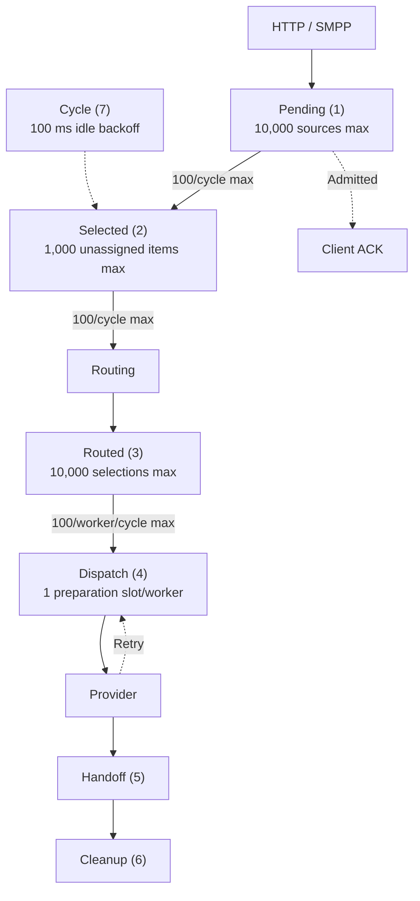
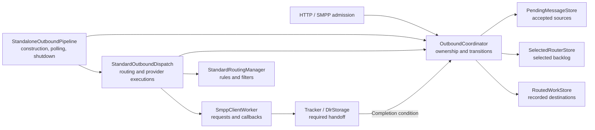
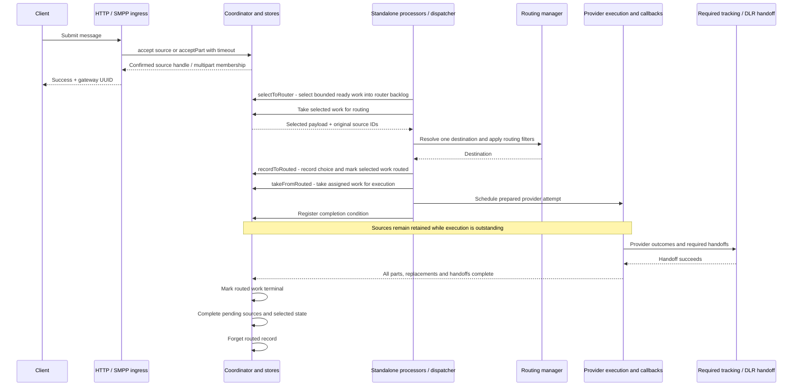
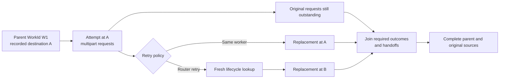
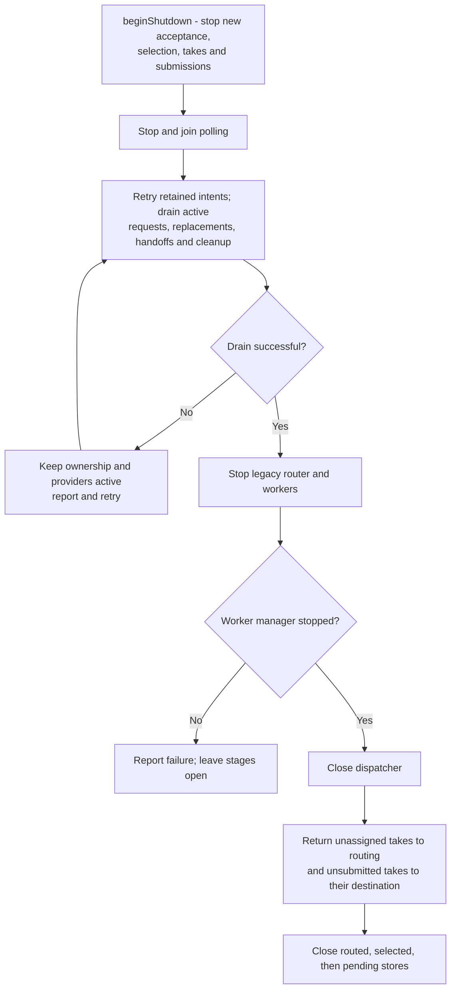

# Outbound Message Storage

Sendium's standalone application processes HTTP/SMPP submissions through one shared outbound lifecycle.
Accepted sources remain owned until provider processing and every required tracking/delivery-report
(DLR) handoff finish. **Acceptance, queue removal and provider submission are not terminal completion.**

**`memory/memory/memory`** remains the non-durable default. Opt-in **`file/memory/memory`** retains
accepted sources across process/container restarts using an explicitly configured local spool path.
Selection and routing repeat after restart; power-loss durability and exactly-once delivery are not guaranteed.
See [Filesystem Pending Storage](16-filesystem-pending-storage.md) for the as-built file architecture,
deployment, stopped-instance backup/restore and rollback procedures.
The contracts are message-neutral; the current standalone provider adapter executes SMPP-client submissions.
The working lifecycle comes from [#338](https://github.com/cytechmobile/sendium/issues/338), with pending-source
contracts, multipart admission and the [versioned CBOR representation](15-pending-record-schema.md) refined by
[#343](https://github.com/cytechmobile/sendium/issues/343), under [#337](https://github.com/cytechmobile/sendium/issues/337).

## Flow Overview

The coordinator governs ownership and transitions across the stages below. **Numbers show shipped
defaults; references such as (1) point to the stage notes.** Store capacities and per-cycle take limits
are separate bounds.



**Only Pending, Selected and Routed are outbound stores.** Dispatch, handoff and cleanup are processing
phases. Arrows show progression, not deletion of earlier records.

### Stage Notes

- **(1) Pending — `PendingMessageStore`:** retains up to **10,000 accepted sources**, including held
  multipart parts and in-flight sources, before HTTP 202 / SMPP success. When full, new admissions fail
  with **HTTP 503** or **SMPP `STATUS_THROTTLED`**. Existing work continues processing; cleanup frees
  space. Moving to a later stage does not free a Pending slot. An aggregate retains every original source ID.
  Acknowledged duplicate multipart handles remain owned with their original ordinal until terminal completion
  and required DLR handoff; their payloads are not routed independently.
- **(2) Selected — `SelectedRouterStore`:** holds up to **1,000 queued or taken unassigned items**.
  Select up to **100 ready items/cycle**, limited by free slots, and route up to **100 takes/cycle**
  through routing rules. When full, additional ready work stays in Pending. Recording a destination
  frees the routing slot but keeps bookkeeping until cleanup. A routing miss or recoverable lookup
  failure returns the item for another attempt; a terminal routing drop discards it. An aggregate uses
  one selected slot; held parts wait for reassembly/publication before selection.
- **(3) Routed — `RoutedWorkStore`:** retains up to **10,000 selections across all destinations**,
  using the same configured capacity as Pending. Records the chosen destination and queues work for
  that worker. Unfinished work includes items waiting to send, awaiting provider outcomes, running
  retries, or waiting for required handoff/cleanup. Taking an item does not remove its ownership record.
  If destination recording fails, retain the original assignment intent and retry without repeating
  routing lookup.
- **(4) Dispatch:** takes up to **100 items per eligible worker/cycle** into per-worker FIFO execution.
  Preparation concurrency is `threadCount` (**default 1**); the shared worker TPS cap defaults to
  **0 = unlimited**. Busy or paused workers leave work waiting. Async responses do not hold preparation
  slots, but their messages still occupy Pending capacity. Provider outcomes drive completion or the
  configured retry policy; multipart requests and replacement attempts keep the original source ownership.
- **(5) Handoff:** finishes required tracking/persistence, including its commit and any required DLR
  enqueue. On failure, retain ownership and retry the handoff, not an already accepted provider request.
  This does not wait for final handset delivery or client acknowledgement of a later receipt.
- **(6) Cleanup:** after all provider parts/replacement attempts are terminal and required handoffs
  succeed, complete routed work, release pending sources, remove selected bookkeeping, then forget the
  routed record. **This frees Pending and Routed capacity.** If cleanup partly fails, retry remaining
  steps without resending provider requests or repeating a successful handoff.
- **(7) Cycle:** one standalone processing thread drives selection, routing and provider takes. All
  three **100-item** limits share `sendium.message.selection-batch-size`, applied separately. Cycles
  do not wait for batches to fill. Continue immediately after productive routing/dispatch; back off
  **100 ms** when idle, paused or unsuccessful.

## Components

`sendium-core` supplies reusable contracts and implementations. `sendium-app` constructs and runs the
standalone pipeline; importing the core library alone does not activate this storage assembly.



| Component | Responsibility |
|---|---|
| `MessageStorageProfile` / `StandaloneMessageStorage` | Validate startup selectors, produce the profile and report its durability limits. |
| `StandaloneOutboundPipeline` | Start one shared coordinator; drive bounded selection, routing, dispatch, retries and drain-first shutdown. |
| `KannelResource` / `SmppServerWorker` | Admit before HTTP 202 / SMPP success; retain original source identities through multipart preparation. |
| `PendingMessageStore` / memory and file implementations | Retain accepted sources, held parts and ready work through source completion. |
| `MultipartKey` / `MultipartMembership` | Match compatible parts and retain each source's assigned group, ordinal, absolute deadline and group creation order. |
| `PendingSourceRecord` / `PendingMessageData` / `PendingRecordCodec` | Explicit accepted-source representation and versioned Jackson CBOR codec; not a physical backend or automatic memory-store encoding. |
| `PendingMultipartRecovery` | Shared record-driven assembly/expiry entrypoint using bounded reads; backend/application startup integration is explicit. |
| `SelectedRouterStore` / `MemorySelectedRouterStore` | Own bounded selection and unassigned routing work; retain selected bookkeeping after routing. |
| `RoutedWorkStore` / `MemoryRoutedWorkStore` | Record one destination per selection and schedule its unfinished work by destination. |
| `DefaultOutboundCoordinator` / `OutboundWork` | Enforce typed source/selection/work ownership, transitions, handoff-dependent completion and retryable cleanup. |
| `StandardRoutingManager` / `StandardOutboundDispatch` | Resolve rules/filters, retain recording intents and schedule tracked provider attempts. |
| `SmppClientWorker` / `SmppClientSessionHandler` / `CoordinatedSmppSubmission` | Prepare/send requests, process callbacks once and join part/replacement outcomes. |
| `Tracker` / `StandardMessageTracker` | Signal successful required handoff; integrate with the independently configured DLR subsystem. |

## Message Lifecycle



- **Identity:** HTTP/SMPP reuse each gateway UUID as its typed `SourceId`. `SelectionId` and `WorkId`
  identify later steps independently of mutable payloads and provider IDs. Return the actual take handle,
  with its updated payload, rather than a reconstructed wrapper; stale returns must not overwrite live work.
- **Incoming multipart:** `acceptPart` retains each part and its group membership before acknowledgement.
  The reassembler makes an aggregate or expired individual parts ready using `makeHeldReady(originalSourceIds, payload)`.
  This creates no new admission; in-process publication retries do not re-acknowledge input or create
  another source binding.
- **Outgoing multipart:** provider requests and replacements share one routed parent and original source
  set. They are not copied-route branches. No source is removed until all required completion conditions succeed.
- **Completion:** `complete(workId, stage)` can register an outstanding condition; it does not immediately
  delete sources. Successful cleanup marks routed work terminal, completes pending sources and selected
  bookkeeping, then forgets routed ownership. Successful steps are remembered for cleanup-only retry.
- **DLR boundary:** completion waits for required handoff acceptance, not a later handset-delivery receipt.
  Receipt storage/delivery remains independent of outbound backend selection.

`StandardOutboundDispatch.routeSelected()` performs routing lookup and filters.
`OutboundCoordinator.recordToRouted(selected, destination)` records that already-chosen result and
advances stage ownership; it does not choose the destination or send the message.
`takeFromRouted(destination, timeout)` takes one assigned item without completing ownership;
`returnToRouted(work)` returns an unfinished take to scheduling at its unchanged destination.
`makeHeldReady(sources, preparedMessage)` binds held sources to the caller-prepared payload without
assembling or accepting new input. `selectToRouter(limit)` then selects eligible work into the router
backlog and returns the newly staged count; it does not evaluate routing rules.

## Pending Sources and Multipart Groups

`PendingMessageStore.admit` and `admitHeld` return the supplied stable `SourceId` only after acceptance.
`OutboundCoordinator.accept` and `acceptHeld` propagate that confirmed handle. A null or substituted
backend result is an ownership failure, never permission to acknowledge untracked work. `acceptPart`
similarly confirms the source in its returned `MultipartMembership`. `admitHeld` remains available for
generic held work without assigning it to a multipart group.

`find(source)` returns an isolated copy of the **accepted** payload. It does not return the later routing
or provider-mutated execution message. `findMultipart(source)` returns immutable membership when present.
`sourcesAfter(cursor, limit)` enumerates immutable pages of at most `limit` handles in `UUID.compareTo`
order; start with a null cursor and continue after the last returned handle. Completion of that cursor
does not invalidate progress. This is a bounded read API, not selection. Recovery callers quiesce ingress
and processing; concurrent admission/completion is not a consistent snapshot.

Every new client submission receives its own source ID, including a repeated multipart ordinal.
Only an **internal retry of the same retained source ID** preserves the first accepted value without
consuming another source slot. A successful earlier client response does not make a later submission
with the same content/reference a deduplicated internal retry.

Multipart matching uses account/system, sender, recipient, reference width/value, declared total and
normalized UDH. Other header bytes are preserved, so different ports or headers do not share a group.
The parser supports one valid 8-bit or 16-bit concatenation element alongside other length-checked IEs.
Assign the part to the open, unexpired matching group; otherwise create a new group instance.
The first accepted source for each ordinal wins. Later sources report duplicate membership referencing
that original source and cannot replace its payload. The first accepted part fixes
the absolute deadline, and subsequent parts or timeout-configuration changes do not extend it.

For **A=part1, B=part1, C=part2, D=part3**, assemble **A+C+D** and retain B's accepted handle with the
same group. All four submissions are acknowledged after admission. Completing the aggregate removes
all four source records after terminal processing and required handoff. B is never routed separately.
On expiry, each received original part publishes with its duplicate handles. Publication atomically
includes those handles even when their ingress notifications have not been processed. Mixing group
instances or publishing an incomplete assigned aggregate is rejected.

The [schema reference](15-pending-record-schema.md) specifies all 54 accepted message fields, DLR return
metadata, multipart membership, extension types and validation rules. It does not serialize
`StandardMessage` directly or instantiate application classes from stored names. Normal memory
operation continues to use its existing snapshot policy; the standalone CBOR mapper is an explicit
library contract for backends, not a new serialization step on every memory admission.

### Record-driven reconstruction

`PendingMultipartRecovery` rebuilds runtime assembly from accepted records, saved assignments and
absolute deadlines. It validates bounded source pages and group-handle indexes before reporting ready.
Complete retained groups assemble in ordinal order; expired incomplete groups release received parts;
unexpired incomplete groups schedule only the time remaining. A restart at 12:00:50 with a saved
12:01:00 deadline leaves ten seconds, not another full timeout.

The memory recovery path retains waiting handles/metadata, not a second payload backlog. `multipartSources(groupId)` reads
one group's retained handles, including duplicates and parts still awaiting ingress notification,
bounded by pending source capacity. There are at most 255 distinct ordinals.
Payloads are fetched for assembly or expiry. Closing recovery cancels its timers; source completion
still belongs to the coordinator after terminal processing and required DLR handoff.

The file path instead uses rebuilt disk group/deadline references and one batch-bounded poller. Backend
opening validates every committed source/membership before coordinator recovery becomes ready; later
publication/expiry visits one group's original payloads at a time. It does not create a heap map or timer
for every retained group. See the [file architecture and bounds](16-filesystem-pending-storage.md#bounds-and-capacity).

There is **no new durable checkpoint of a runtime assembly, release or publication decision**.
Pending-only recovery may repeat processing. Selection/destination decisions survive only under
their own configured stage guarantees. Within a running process, `makeHeldReady` retains the first
source-to-projection binding and prepared payload, making publication retries idempotent.

`SmppServerWorker.reconstructPendingParts(pending, pageSize)` is an explicit pre-ingress startup hook
using its selected coordinator's publication boundary for handler-owned recovery. It prevents worker
startup/admission success after failed reconstruction. Standalone file-profile workers instead attach
to the coordinator's automatically initialized shared recovery; they cannot reconstruct or close that
borrowed component. Memory remains the non-durable default. Durable selected/routed stages remain
separate future work, not an implied guarantee of pending recovery.

## Ownership and Capacity

The stores are process-local objects, not three independent batches. The routed store contains queues
for recorded destinations; it is **not** the worker's legacy `msgQ` or a disk directory.

For three groups of 100 distinct, unfinished, single-source messages:

| Location in the flow | Pending source records | Selected records | Routed records |
|---|---:|---:|---:|
| 100 ready, not selected | 100 | 0 | 0 |
| 100 selected, not assigned | 100 | 100 | 0 |
| 100 assigned, queued or executing | 100 | 100 retained as bookkeeping | 100 |
| Total logical ownership | **300** | **200** | **100** |

Only the unassigned group occupies router queue capacity. Recording a destination frees its routing
slot but retains the selected record until cleanup. These counts are not physical payload-copy or RAM counts.

| Setting | Default | Meaning |
|---|---:|---|
| `sendium.message.pending.capacity` | 10000 | All retained accepted sources, including held parts and sources executing at later stages. |
| `sendium.message.router-queue.capacity` | 1000 | Queued plus taken unassigned selections; taking does not free a slot. |
| `sendium.message.selection-batch-size` | 100 | Maximum new selections, routing takes and takes for each eligible destination per processing cycle. |
| Routed capacity | Same as pending capacity | Retained destination records across all workers, including terminal records awaiting cleanup; no separate setting. |

With 950 occupied router slots, capacity 1000 and batch size 100, at most **50** new selections fit.
A group of N accepted multipart sources uses N pending slots but one selected slot and one routed record.
Partial terminal cleanup can retain routed records after source removal, so equal capacities do not
eliminate cleanup-related backpressure or provide cross-store transactions.

The processor schedules the next bounded cycle without a mandatory delay after successful routing
or provider scheduling. Idle, paused, or unsuccessful cycles back off for 100 milliseconds;
selection or returning an unroutable item alone does not count as progress. Shutdown prevents
further cycle scheduling. Batch size is not TPS or provider
concurrency: attempts use the worker's shared rate limiter and a dispatcher-owned execution pool
sized by its `threadCount`. At most that many preparation loops execute concurrently, taking waiting
attempts from the worker FIFO. The default shared two-thread scheduler handles destination resolution
and timed retries; rate waits, worker filters, and SMPP sends run on the worker's pool.
Stopped-worker pools are retired during transition maintenance, and dispatcher close shuts down
its worker pools after provider drain even when the timer scheduler is application-owned.
Awaiting asynchronous outcomes does not hold a sending slot. Count limits do not bound message bytes.

## Retries and Failures



The parent keeps its **initial destination**, while runtime attempts carry their actual destinations.
Router retries resolve routing again without new admissions or a parent transfer. Existing full-message
versus individual-part retry choices are preserved. Attempt progress is non-durable; this is not exactly-once delivery.
`requeueForRouting` puts taken unassigned selections back in the selected backlog.
`returnToRouted` preserves the assigned destination. Provider router retries are separate runtime
attempts, not either storage-return operation.

| Boundary | Behavior |
|---|---|
| Unsupported backend profile | Fail startup with requested/supported choices; no fallback to memory. |
| Admission capacity/unavailability | HTTP 503; SMPP capacity returns `STATUS_THROTTLED`. Failed admission is not acknowledged as success. |
| Routing miss / nonterminal lookup failure | Use `requeueForRouting` with ownership retained. A terminal routing drop uses `discard`. |
| Copied route / unsupported standalone destination | Reject before assignment, even if a copied rule resolves to one target. The existing legacy copied-routing API remains separate. |
| Destination-recording failure | Retry the retained original intent without repeating lookup or routing filters. |
| Required handoff failure | Retain ownership and retry the handoff, not an accepted provider request. |
| Terminal cleanup failure | Retry unfinished cleanup without awaiting another successful handoff or redispatching provider work. |
| Uncertain source absence | Completion fails explicitly; only established absence on a ready backend permits idempotent success. |
| Corrupt/unknown-version recovery input | Fail reconstruction/readiness explicitly; do not skip the source or treat it as completed. |

Each provider response is claimed once; duplicate callbacks cannot create another replacement or
complete unrelated sources. Same-source-ID admission idempotence applies while ownership is retained,
not forever; new client submissions remain independent.
Runtime worker removal's legacy queue return does not migrate coordinator-owned parent records.

Provider preparation uses a per-worker FIFO of already-owned runtime attempts. Up to the worker's
`threadCount` preparation threads drain it directly as capacity becomes available; busy work does not
create a separate contention timer per message. Paused backlogs share one worker wake-up. Preparation
capacity is released after preparation/submission, without waiting for asynchronous provider responses
or DLR handoffs. The retained source-capacity bound still governs admitted work.

Each provider execution retains one private completion monitor per terminal-cleanup attempt. Status
polling reuses that monitor, and repeated drain timeouts wait on completion notifications instead of
attaching new future copies or aggregate completion trees to outstanding work.

The standalone pipeline contributes the `standalone-outbound` readiness check. Recoverable processing
cycle failures back off and retry. A fatal cycle failure or failed rescheduling is logged with its
exception and makes readiness DOWN, with only the failure class exposed in health data. Readiness is
also DOWN before pipeline activation and during shutdown; a terminated chain is not silently restarted.

## Graceful Shutdown



Providers, callbacks and replacement scheduling stay active during drain. Standalone shutdown has no
forced drain cutoff; unresolved work keeps it waiting and logging. Stop failure or refused closure is
not terminal success. Application-owned schedulers are not closed by the dispatcher.

`beginShutdown()` starts this process by stopping new lifecycle work; it does not itself drain providers,
stop workers or close stores. The application performs those steps before `close()`.

Execution becomes active when `submitToProvider` registers its scheduled attempt, even before the first
network send. These attempts must drain. Queued routed work not handed to that boundary keeps its chosen
destination; shutdown does not submit the entire pending/selected/destination backlog merely to empty it.

For the 100-message groups above, ready work stays pending, unassigned takes return to routing, and
unsubmitted work stays at its destination. Started executions complete normally before closure.
**Memory close clears remaining unfinished records. There is no shutdown-time switch to disk storage.**

## Configuration and Restart Guarantees

All selectors and bounds are global, startup-only Quarkus configuration. See the
[configuration reference](09-configuration-reference.md#outbound-message-storage-profile) for defaults,
environment variables and overrides. Selectors default to `memory`; blank, unknown or unimplemented
values fail. Capacity/batch values must be positive.

`StandaloneMessageStorage` validates before watcher/worker startup and reports the profile's durability limits.
`StandaloneOutboundPipeline` separately starts the shared coordinator and activates polling after
existing router/worker startup. A failing coordinated admission never falls back to a legacy queue.

| Pending / selected / routed | Availability | Restart behavior |
|---|---|---|
| `memory/memory/memory` | Implemented and activated; default | No recovery across closure/restart. |
| `file/memory/memory` | Implemented; explicit pending path required | Recover sources; reselect and reroute. |
| `file/file/memory` | Future [#345](https://github.com/cytechmobile/sendium/issues/345) | Recover selected work; reroute. |
| `file/memory/file` | Future #345 | Reselect not-yet-routed sources; restore recorded destinations. |
| `file/file/file` | Future #345 | Restore selected work and recorded destinations. |
| PostgreSQL profiles | Future [#333](https://github.com/cytechmobile/sendium/issues/333) | Only explicitly implemented combinations. |

Future profiles are not selectable today. Memory remains the non-durable default; file profiles
are opt-in. Durable recovery must reconcile identities and resume the latest recorded stage without
scheduling earlier retained records independently. It requires surviving storage and remains at least
once: provider submission before recorded completion may repeat. The CBOR source codec is implemented;
durable later-stage implementations belong to subsequent issues. Durable provider
outcome/retry checkpoints remain outside this delivery.

### Storage readiness and metrics

`/q/health/ready` includes `sendium-sms-storage`. It is UP only while the shared coordinator
is running, all selected stores report READY, and any coordinator-owned multipart recovery is safe.
Shutdown, a failed store or unsafe recovery makes this check DOWN. Health probes do not scan the spool
or imply that its retained backlog is empty. Custom coordinator implementations must implement
`isReady()` to report readiness; the default is conservatively false.

Standalone file pending records the Micrometer timer `sendium.sms.storage.operation`, including
lock-wait time, for opening/reconstruction, admission, source reads/pages, multipart recovery operations,
held publication and terminal cleanup. Timer counts with `outcome=error` provide operation error counts.
Labels are restricted to `backend=file`, fixed operation names, `outcome=success|error`, and a typed
storage `reason` (`NONE` for success, `OTHER` for non-storage failures). No message, account, group or
path labels are emitted. Status probes are not timed and metric collection does not enumerate files.
Embedded file stores opt in by supplying a `MeterRegistry` to the constructor.

After source validation/reconstruction, `pendingRecovery|success|backend:file|retainedSources:…|durationMs:…`
reports retained source count and startup duration without payloads or paths. This summary does not
mean the multipart backlog has drained; bounded group publication can continue after startup.

### Delivery and rollback boundary

The existing `utils.NativeE2eSmoke` can verify retained-volume recovery against a freshly built JVM
or native image. Keep its normal PostgreSQL fixture running and set:

```sh
export SENDIUM_E2E_IMAGE=sendium:your-test-image
export SENDIUM_E2E_PENDING_RESTART=true
./mvnw -pl sendium-core -DskipTests test-compile \
  org.codehaus.mojo:exec-maven-plugin:3.5.1:java \
  -Dexec.classpathScope=test -Dexec.mainClass=utils.NativeE2eSmoke
```

This opt-in smoke creates its own named spool volume, pauses routing, checks committed HTTP/SMPP
and duplicate multipart admissions, forcibly removes the container, and starts a replacement on the
same volume with routing resumed. It then finishes the recovered multipart group and checks provider
content, required source cleanup and HTTP/SMPP DLR delivery. Test containers/volume are removed at
the end; this is not a production backup/restore command. Without the flag the existing memory-profile
PostgreSQL correlation/restart smoke remains unchanged. The fixture uses ports 18080, 27777 and 27779.

Rollback from file pending is not code-only: drain accepted sources first or stop and preserve the entire
spool for later compatible recovery. Switching to memory does not migrate retained work. PostgreSQL DLR
storage remains independently owned. Follow the [file-profile rollback procedure](16-filesystem-pending-storage.md#rollback-or-switching-back-to-memory).

## Embedding and API Reference

Embedding applications supply compatible `M extends StandardMessage` stores, selection/preparation,
snapshot policy, tracking handoffs and lifecycle orchestration. Constructors are passive; the default
coordinator requires fresh stages and supports indexed durable pending recovery with memory selected/routed
stores. Durable selected/routed stages remain unsupported. `FilePendingMessageStore` uses the explicit
`StandardMessage` representation, not arbitrary custom-subtype serialization.

Custom subtype fields and runtime mutations must survive transitions/returns without changing retained
earlier-stage payloads. `StandaloneMessageSnapshot` handles standard protocol payloads and supported
mutable fields; custom types require an application-owned mapper/assembly. Shared message naming leaves
room for future OTT integrations without claiming current Viber/WhatsApp execution support.

Detailed operation, idempotence and failure rules are defined in the tracked Java contracts:

- [OutboundCoordinator](../sendium-core/src/main/java/gr/cytech/sendium/core/outbound/OutboundCoordinator.java) and [OutboundWork](../sendium-core/src/main/java/gr/cytech/sendium/core/outbound/OutboundWork.java)
- [PendingMessageStore](../sendium-core/src/main/java/gr/cytech/sendium/core/storage/PendingMessageStore.java)
- [PendingRecordCodec](../sendium-core/src/main/java/gr/cytech/sendium/core/storage/pending/PendingRecordCodec.java) and [pending record schema](15-pending-record-schema.md)
- [PendingMultipartRecovery](../sendium-core/src/main/java/gr/cytech/sendium/core/storage/pending/PendingMultipartRecovery.java)
- [SelectedRouterStore](../sendium-core/src/main/java/gr/cytech/sendium/core/storage/SelectedRouterStore.java)
- [RoutedWorkStore](../sendium-core/src/main/java/gr/cytech/sendium/core/storage/RoutedWorkStore.java)
- [OutboundStage](../sendium-core/src/main/java/gr/cytech/sendium/core/storage/OutboundStage.java) and [OutboundStorageException](../sendium-core/src/main/java/gr/cytech/sendium/core/storage/OutboundStorageException.java)

Verification covers real HTTP/CDI admission, SMPP acknowledgement/reassembly, multipart callbacks,
rerouting and failed handoffs while shutting down, custom-message isolation and application-owned lifecycle,
shutdown ordering and startup rejection. Provider transport/handoffs use controlled fixtures, not a live
external provider. Key tests are [StandaloneOutboundPipelineTest](../sendium-app/src/test/java/gr/cytech/sendium/app/storage/StandaloneOutboundPipelineTest.java),
[SmppClientWorkerTest](../sendium-core/src/test/java/gr/cytech/sendium/core/smpp/client/SmppClientWorkerTest.java) and
[OutboundEmbeddedLifecycleTest](../sendium-core/src/test/java/gr/cytech/sendium/core/outbound/consumer/OutboundEmbeddedLifecycleTest.java).
Pending-specific proofs are [MemoryPendingMessageStoreContractTest](../sendium-core/src/test/java/gr/cytech/sendium/core/storage/pending/MemoryPendingMessageStoreContractTest.java),
[PendingRecordMappingTest](../sendium-core/src/test/java/gr/cytech/sendium/core/storage/pending/PendingRecordMappingTest.java),
[PendingRecordCodecTest](../sendium-core/src/test/java/gr/cytech/sendium/core/storage/pending/PendingRecordCodecTest.java),
[PendingCompletionFailureTest](../sendium-core/src/test/java/gr/cytech/sendium/core/storage/pending/PendingCompletionFailureTest.java) and
[PendingMultipartRecoveryTest](../sendium-core/src/test/java/gr/cytech/sendium/core/storage/pending/PendingMultipartRecoveryTest.java).
Codec-backed reconstruction fixtures are not physical file-publication or forced-process restart tests.
