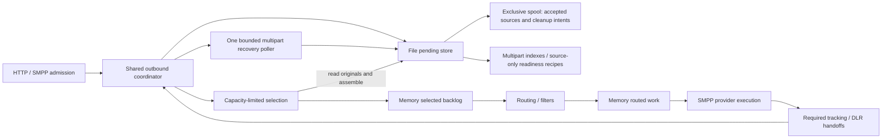
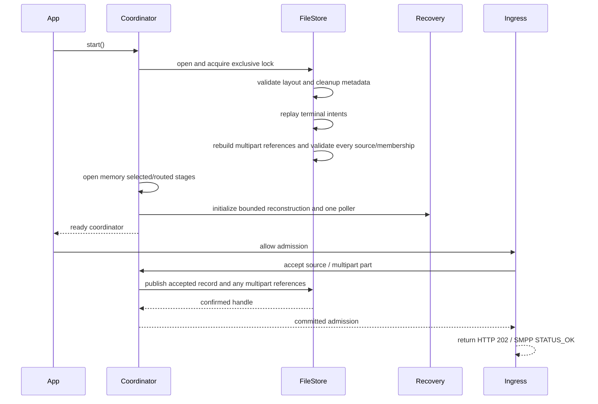

# Filesystem Pending Storage: Architecture and Operations

[Documentation map](DocumentationMap.md) · [Outbound lifecycle](14-outbound-storage.md) · [Source schema](15-pending-record-schema.md)

## What this profile guarantees

`file/memory/memory` retains accepted HTTP/SMPP source records across **process/container restart
when the same spool storage survives**. `memory/memory/memory` remains the default. Selection,
routing decisions and provider execution are volatile: retained sources are selected and routed again
after restart. Existing PostgreSQL provider-correlation and downstream DLR storage remain separate.

This is **at-least-once provider processing**, not exactly-once delivery, a durable retry scheduler,
or host-power-loss durability. There is no filesystem/DB/provider transaction. A crash after sending
to the provider but before source completion can repeat submission. A lost client response can also
cause a duplicate when the client retries. An admission error after publication does not prove that
no source was committed. Use application-level reconciliation where duplicates matter.

Only pending storage is durable in this profile. File selected/routed stages, PostgreSQL outbound
stages and copied-route execution are not enabled by it.

## Components and ownership



- `StandaloneOutboundPipeline` constructs compatible stores and starts the coordinator before returning
  it to admission. Unsupported profiles, missing paths and unsafe storage fail without memory fallback.
- `DefaultOutboundCoordinator` owns store startup, one shared recovery component and coordinated source
  completion. Stopping an SMPP worker does not stop shared recovery; handlers only borrow it.
- `FilePendingMessageStore` retains accepted content, multipart identity and absolute deadlines.
  Mutable execution messages are detached from the accepted source snapshot.
- The selected/routed stores remain memory projections. Completion retains source ownership until every
  required provider-part/tracking/DLR handoff succeeds. A failed handoff is not terminal cleanup.
- Recovery shuts down outside the coordinator lock, before stores close, to avoid deadlock with a
  recovery callback. Closing stores preserves unfinished sources; it is not completion.

## Physical layout

Treat the entire directory as private application state, not a public file API:

```text
pending/
  owner.lock                         OS-held exclusive ownership; not a stale-lock flag
  format                             sendium-pending-spool:2 followed by newline
  accepted/
    3/<bucket>/<source-UUID>.cbor      high priority
    2/<bucket>/<source-UUID>.cbor      normal priority
    1/<bucket>/<source-UUID>.cbor      low priority
  terminal/<intent-UUID>.cbor         committed cleanup authorization
  closed-groups/<bucket>/<UUID>.closed
  derived/                           disposable, rebuilt while opening the spool
    multipart/
      groups/<group-UUID>/
        members/<source-order-key>   references to originals and duplicates
        ordinals/<ordinal>           file containing that ordinal's original source UUID
        due-key                      reference to the group's current scheduled time
      matching/<hash-prefix>/<matching-key-hash>/<group-order-key>
      due/<deadline-and-group-key>
      ready/
        3/<representative-order-key>
        2/<representative-order-key>
        1/<representative-order-key>
    publications/
      work/<publication-UUID>.cbor    source-only readiness recipe, never a message body
      bindings/<bucket>/<source-UUID>
```

Each accepted bucket is the first two lowercase hexadecimal characters of its source UUID (`00`–`ff`);
only populated buckets need exist. An accepted source always stays in its admission-priority folder,
including after multipart assembly, selection or routing. There is no separate authoritative parent
message file and no ordinary source, priority or ready-reference index.

The derived tree above shows logical reference locations. Its `members`, `matching`, `due` and `ready`
indexes split large leaves into `children/<hex-pair>/…` directories; the full reference key remains the
leaf filename. Source-order keys are 32 hexadecimal characters encoding Java UUID comparison order,
not hyphenated UUID filenames. Matching references use 48-character group-order keys and deadline
references use 56-character time/group keys. These implementation details are not an external file API.

Accepted CBOR sources are authoritative. Each accepted multipart duplicate has its own source record;
the first ordinal payload remains the assembly owner. Cleanup intents and group-closure markers are
also authoritative: dropping them can resurrect terminal work or reopen an unfinished closed group.
`derived/` is disposable to **the locked startup implementation**, not permission to edit a running spool.
It contains only multipart lookup/deadline/ready references and source-only recipes/bindings.
No embedded database is used; folder references are reconstructed from the authoritative state.

### Example: two parts and a duplicate

These are three distinct acknowledged source files, even though they produce one provider message:

```text
accepted/2/ab/ab000000-0000-4000-8000-000000000001.cbor   part 1: "Hello "
accepted/1/cd/cd000000-0000-4000-8000-000000000002.cbor   part 2: "world"
accepted/3/ef/ef000000-0000-4000-8000-000000000003.cbor   duplicate of part 1
```

All three records embed the same `multipart.groupId`, matching key and fixed deadline. Their ordinals
are 1, 2 and 1. The first two have `originalSourceId` equal to their own source UUID; the duplicate's
`originalSourceId` points to `ab000000-0000-4000-8000-000000000001`. This embedded membership, not
their directories or a sender-provided multipart reference alone, identifies which group they belong to.
See the [membership schema](15-pending-record-schema.md#multipart-admission-and-membership).

Recovery registers a recipe containing the two original UUIDs in ordinal order and ownership of all
three source UUIDs. It does **not** write an assembled "Hello world" payload. Only when a router slot
is available does selection read the original parts and assemble that detached message in memory.
Assembly preserves the first ordinal's priority (2 here), not the duplicate's priority or the highest
priority among the parts. Terminal completion removes all three owned source files. For an incomplete
expired group, each received original is forwarded independently with its duplicates, preserving its UDH.

Recipe schema 2 has `schemaVersion`, `publicationId`, `sources`, ordered `originals`, `priority` and
`assembled` fields—no `message` field. Recipes preserve same-process idempotency/ownership, not a durable
execution checkpoint. The file backend rejects generic `makeHeldReady(sources, replacementPayload)`
with `UNSUPPORTED`; its internal source-only readiness operation derives assembly or single-original
forwarding from accepted data. Memory-backend arbitrary-payload publication is unchanged.

Publication writes and closes a unique same-filesystem temporary file, then creates the committed name
using an atomic **non-replacing hard link**. Existing committed records are never overwritten. Successful
multipart admission also requires safe membership-index updates before protocol success. Ordinary
admission has no derived disk-index update. Known temporary names are
cleaned during locked recovery; unexpected committed filenames, unsupported formats and corrupt
committed records fail startup rather than being silently ignored. Symbolic links are not supported spool entries.
No `fsync`/power-loss guarantee is claimed.

The spool format marker is separate from accepted-record schema version 1 and recipe schema version 2.
Old spool markers or an old `sources/` tree are rejected before temporary cleanup or derived-state
rebuilding. There is no conversion, automatic deletion or migration of old spools. Preserve old data
and use its compatible binary to drain it; changing the marker or renaming directories is not migration.

Terminal completion first publishes a cleanup intent, then removes authorized sources and associated
references. Group-closure markers survive while siblings remain. If the process dies during deletion,
startup replays the committed intent before validating duplicate/original relationships.

## Startup and restart sequence



Readiness means validated ownership and initialized safe recovery, **not an empty backlog**. Complete
groups assemble again from original accepted parts. Incomplete groups retain their original absolute
deadline; a later part or timeout reconfiguration does not extend it. Expired originals become independent
routing work while duplicate source handles remain owned through completion.

Startup discards old recipes/bindings and rebuilds readiness from accepted membership rather than
resuming old assembly/routing decisions. Payload assembly waits for selection capacity.
Current routing configuration/filters therefore apply again to retained sources. Plan configuration changes
accordingly; restart is not a promise to use the previous destination or provider retry timing.

## Deployment

Select the profile using startup-only application settings, not `smsg.properties`:

```properties
sendium.message.pending.backend=file
sendium.message.pending.path=/work/spool
sendium.message.router-queue.backend=memory
sendium.message.routed-work.backend=memory
```

For Docker, add these arguments to your normal JVM or native deployment, preserving its configuration,
ports and PostgreSQL settings:

```sh
--mount type=volume,source=sendium-pending,target=/work/spool \
-e SENDIUM_MESSAGE_PENDING_BACKEND=file \
-e SENDIUM_MESSAGE_PENDING_PATH=/work/spool \
-e SENDIUM_MESSAGE_ROUTER_QUEUE_BACKEND=memory \
-e SENDIUM_MESSAGE_ROUTED_WORK_BACKEND=memory
```

Create/provision the volume explicitly and ensure the runtime UID can create, link, read and delete
files/directories there. Restrict access: the spool contains SMS content, addressing and return metadata.
CBOR is an encoding, not encryption; protect the underlying disk/volume and backups accordingly.
Use a writable local filesystem with working hard links and exclusive file locks. Linux/ext4 and native
container behavior were verified; shared/network filesystems and multi-writer use are not supported
deployment guarantees. Do not use an ephemeral container layer, an in-memory mount, or a new empty
volume on every replacement. A volume still needs its own retention/backup policy and survives only the
failures its storage platform actually tolerates.

Run **one owner per spool**. A second process must fail with an ownership conflict. Never delete or
replace `owner.lock` to bypass a conflict; that can allow different processes to lock different inodes.
Verify the old process/container has exited and investigate the mount/owner instead.

## Bounds and capacity

- Pending capacity defaults to **10,000 retained sources**, including each multipart duplicate and sources
  already selected, routed or awaiting required handoffs. It is not a byte quota or free-disk reservation.
  Recovered sources are not discarded when capacity is lowered; new admission is blocked while full.
- Selection/recovery batch size defaults to **100**. Ordinary selection traverses accepted directories
  directly with persistent cursors, at most three directory streams and a **1,024-step** per-call scan
  budget. Three in-memory waiting counts skip known-empty priorities, and runtime active-source
  ownership prevents reselection without disk markers. Accepted buckets are streamed, not sorted or
  limited to 128 records. Only the remaining derived reference indexes have **128-entry** leaf bounds.
- Selection prefers priorities **3, 2, 1**. It resumes within a priority rather than repeatedly choosing
  the smallest UUID; there is no FIFO promise or instantaneous preemption for concurrent admissions.
  A budget-limited scan may return no work before exhaustion; later selection calls continue the cursor.
- File multipart recovery uses one poller (100 ms interval) and disk deadlines, not one timer/payload
  map per group. It registers source-only readiness. Selection loads at most one group's original
  payloads at a time (protocol total at most 255), only after router capacity is available.
  Duplicate ownership sets and selected execution metadata still grow with owned handles, bounded by
  retained-source capacity; this is not a constant-byte-memory claim.
- Startup validates/reindexes all committed sources; its time and filesystem metadata cost grow with
  backlog. Payload sizes, disk bytes/inodes and filesystem latency need operational headroom. Watch
  storage metrics and startup duration; do not infer an unmeasured throughput or startup-time SLO.
- Ordered administrative `sourcesAfter` pages retain only the requested number of IDs but may scan the
  accepted tree for each page. File startup and ordinary selection do not repeatedly use that API.

See [configuration defaults](09-configuration-reference.md#outbound-message-storage-profile) and
[readiness/metrics](14-outbound-storage.md#storage-readiness-and-metrics). Disk/permission/index failures
can leave committed records retained while readiness/admission fail closed. Capacity rejection does not
itself mean corrupt storage. Diagnose the typed failure; do not make the service ready by deleting data.

## Stopped-instance backup and restore

1. Fence new HTTP/SMPP submissions. Stop the owning process/container and verify it has exited.
   Do not copy a live spool or use the presence/absence of the lock file to infer process ownership.
2. Back up the **entire spool root**, including `format`, `accepted`, `terminal` and `closed-groups`.
   Preserve ownership, permissions and contents. Including `derived/` is safe; startup rebuilds it.
   Store the backup outside the spool, encrypt/protect it and record the application version/configuration.
3. Back up PostgreSQL DLR state under its separate operational procedure. There is no atomic joint
   filesystem/PostgreSQL snapshot: coordinate the recovery point and reconcile provider/DLR ambiguity.
4. Restore into a separate, empty destination while all potential owners are stopped. Do not merge
   source directories from different backups/runs, edit records, or overlay an active spool.
5. Restore suitable runtime ownership/permissions and start one format-compatible file-profile instance
   against that destination. Require `sendium-sms-storage` readiness and inspect recovery diagnostics
   before reopening ingress. Expect reselection/rerouting and possible duplicate provider submission.

A successful restore replays retained work, not an exact external-provider history. Unknown-version or
corrupt committed data must be investigated from the preserved backup; there is no automatic migration,
quarantine or memory fallback. A plain restore of an older backup can replay messages completed since
that backup. Never test a restored copy against a live provider unintentionally.

## Rollback or switching back to memory

Changing the backend selector does **not** migrate or drain retained files. Choose one safe route:

- **Drain first:** fence new ingress while the current service can still process work. Allow complete/
  expired multipart work, provider outcomes and required handoffs to finish. Stop the owner, then verify
   there are no committed `accepted/<priority>/<bucket>/*.cbor` files. Retain a backup and the separate PostgreSQL
  DLR state before switching. An empty pending spool does not mean PostgreSQL's downstream DLR queue
  is empty.
- **Preserve for later recovery:** stop the owner and preserve the full spool plus compatible application
  version/configuration. A temporary memory deployment must use its own lifecycle/storage; it cannot
  recover these files. Returning to the retained file spool can repeat earlier provider submissions.

Do not roll an unreadable spool forward by deleting committed files, and do not start an older binary
against an unsupported spool format. Reusing a preserved spool later requires an explicit reconciliation
plan; it is not a transparent code-only rollback.

## Verification and remaining limits

Tests cover immutable source ownership, folder bounds, codecs/corruption, permissions/capacity/locking,
multipart duplicates/deadlines, publication and terminal replay, shared recovery, protocol acknowledgement
ordering, readiness and bounded-label metrics. Forced child-JVM tests kill the writer without cleanup at
admission/selection/routing/provider-handoff boundaries. Live JVM/native container smokes use a retained
named volume and real HTTP/SMPP/PostgreSQL DLR fixtures, including a multipart group completed after
replacement. These are not power-loss or live-carrier exactly-once tests.

The performance workflow can select either pending backend independently of JVM/native and HTTP/SMPP;
its [results record the profile](../performance/workflow/README.md#sendium-build-and-runtime-details).
Local deployment rehearsals verify that path, not AWS throughput conclusions. Copied execution remains
unsupported under the [stage contract](https://github.com/cytechmobile/sendium/issues/344), rather than
silently dropping branches.

### Measured t4g.small examples, not a capacity guarantee

User-run JVM/HTTP tests of commit `12c9442` used `file/memory/memory`, DLRs, an unlimited worker TPS
cap, 120 seconds of warm-up and 600 seconds of measurement. Both ran on `t4g.small` in Standard
credit mode and completed every accepted message and DLR without rejection, failure or timeout:

| Offered rate | Accepted/completed/DLRs | ACK p99 | Provider response completion p99 | Drain |
|---|---:|---:|---:|---:|
| [100/sec](https://github.com/cytechmobile/sendium/actions/runs/43851583336) | 60,000 each | 23.87 ms | 119.04 ms | 2.38 s |
| [200/sec](https://github.com/cytechmobile/sendium/actions/runs/43861573021) | 120,000 each | 28.16 ms | 123.78 ms | 1.67 s |

Neither run showed growing provider backlog. At 100/sec the observed Sendium credit balances rose;
at 200/sec they fell (2.23, 0.90, 0.38 in coarse samples). A complete five-minute bucket at 200/sec
used 3.33 credits versus the instance's 2-credit earnings for that duration. Therefore **200/sec was
demonstrated for ten minutes, not established as long-term credit-neutral throughput**. The user chose
not to extend this experiment. These results do not isolate filesystem-operation savings from other
changes or establish multipart/SMPP/native throughput, a maximum rate, or a 300/sec guarantee.
