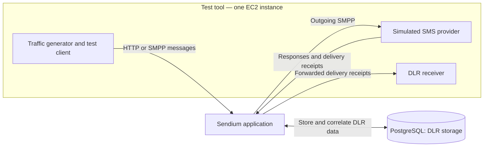

# Sendium performance tests

These tests measure how Sendium handles synthetic messages and delivery reports
(DLRs). They exercise the real application and PostgreSQL database, using a
simulated SMS provider. **No real SMS messages are sent.**

## How it works

The test tool submits messages to Sendium through HTTP or SMPP. Sendium routes and
forwards them to the tool's simulated SMPP provider. The provider returns
submission responses and, when requested, successful delivery receipts after
configurable delays. Sendium uses PostgreSQL to persist and correlate DLR data,
then forwards the receipts back to the test tool through HTTP or SMPP.

The code calls the complete test tool a **test harness**. The simulated provider
is only one part of it; the other parts generate traffic, receive DLRs and record
measurements.

Each run has three traffic phases:

- **Warm-up:** exercise the application before collecting measured message totals.
- **Measurement:** offer traffic at the requested average rate and record outcomes,
  timing and resource usage. Brief timing variation and recovery bursts are visible
  in the results; responses do not pace new submissions.
- **Drain:** stop generating new messages and wait, up to a limit, for submitted
  messages and receipts to finish. Unfinished work remains visible in the report.

## Components

| Component | Responsibility |
|---|---|
| **Test-tool EC2** | Generates traffic, simulates the provider, receives forwarded DLRs, and records message counts and timing. These roles share one process. |
| **Sendium EC2** | Runs the selected application version, separately from the test tool. |
| **RDS PostgreSQL** | Persists delivery-report data and provider-message correlations. |
| **Private networking** | Connects the nodes, database and AWS management services without public instance IPs. |
| **GitHub Actions and AWS orchestration** | Build the exact application/test-tool revisions, provision resources, execute through Systems Manager, collect evidence, clean up and publish reports. |
| **Expiry service** | Independently attempts cleanup of expired or abandoned runs if normal cleanup did not complete. |

Run-owned EC2, RDS and networking resources are temporary. The bootstrap roles,
artifact bucket and expiry service persist between runs. The
[local rehearsal](local/README.md) runs the traffic against real Sendium and
PostgreSQL in containers, while explicitly modeling AWS control-plane operations.

## Metrics collected

### Did the test tool supply the requested load?

These measurements describe the **test tool**, not Sendium's outgoing sending
rate or internal queues.

| Measurement | Meaning |
|---|---|
| **Requested versus attempted input rate** | The message rate we asked the generator to produce versus the number of attempts started in its test client per second. An attempt does not prove arrival or acceptance at Sendium. |
| **Planned messages not attempted** | Scheduling misses are targets left unattempted when generation ends or is stopped. Capacity misses occur when the tool cannot start an attempt because its outstanding-request or message-tracking limit is full. Neither is a rejection returned by Sendium. |
| **Generator timing delay** | How late an attempt starts compared with its nominal planned time. For example, planned at 1.000 seconds and started at 1.030 seconds means 30 ms late. This measures timing variation, not network or Sendium processing time. |
| **Attempt starts and send-call starts each second** | Counts messages handed to the test client and messages for which that client begins its transport call. Differences reveal local preparation or dispatch waiting. They show short-term traffic variation, not confirmed arrivals at Sendium. |
| **Test-client waiting time before sending** | Time from starting an attempt in the test client until beginning its transport call, including preparation and local dispatch-queue waiting. It excludes network travel and Sendium's queues. |

The nominal planned times are a timing reference. Briefly late attempts may
recover in short bursts; they are not automatically discarded.

### How did Sendium handle that load?

| Measurement | Meaning |
|---|---|
| **Submission outcomes** | How many requests Sendium accepted or rejected, and how many attempts failed or timed out without a definite acceptance/rejection response. |
| **Provider and DLR outcomes** | Messages observed by the simulated provider, provider responses completed, receipts generated and receipts forwarded back by Sendium. Missing receipts, duplicates and unfinished work are counted separately. |
| **Completions during each minute** | Messages arriving at the provider, provider responses completed and forwarded DLRs received during that minute. Counts divided by the observed time give messages per second. |
| **Outstanding work at each minute's end** | Messages still awaiting Sendium's acknowledgement, accepted messages awaiting provider completion, and accepted messages awaiting a forwarded DLR. These counts come from observed progress; they are **not direct measurements of Sendium's internal queue sizes**. |
| **Time to finish remaining work** | After generation stops, how long messages and receipts take to finish, whether the drain time limit is reached, and how much remains unfinished. |
| **Resource usage** | CPU and resident memory (RSS) for Sendium and the test tool, host CPU/memory, and available EC2 CPU-credit observations. This helps distinguish application pressure from test-tool pressure. |

For example, a minute can contain 5,400 provider completions while 1,200 accepted
messages are still awaiting completion at that minute's end. The first number is
output during the minute; the second is outstanding work at a point in time.

Processing times are reported with **p50/p95/p99 percentiles**:

| Timing | Boundary measured |
|---|---|
| **Admission acknowledgement** | Test-client transport start to Sendium's acceptance/rejection response. |
| **Submission to provider arrival** | Test-client transport start to the simulated provider observing the message. |
| **Provider response completion** | Test-client transport start to the simulated provider completing its response write. This does not prove Sendium consumed the response. |
| **Simulated receipt delay** | Provider response completion to the simulator generating the DLR. This is an intentional, configured delay. |
| **Receipt forwarding** | Simulator DLR generation to receipt of the DLR forwarded by Sendium. The simulated receipt delay above is excluded. |

For example, p99 of 2 seconds means about 99% of the recorded samples completed
within 2 seconds; it is not the average or maximum. Timings must be read alongside
unfinished-message counts because unfinished work has no completion sample yet.

**Acceptance is not delivery, and eventual completion during drain is not sustained
measurement-period throughput.** Read completion rates, latency and backlog
together. A valid report means the observations passed the accounting/evidence
checks; it does not imply a performance target was met or that all work completed.

Reports also identify inconsistent message accounting and missing or coarse
measurement evidence, rather than silently treating missing data as zero.

Detailed definitions are in the [harness documentation](harness/README.md) and
[result contracts](contracts/README.md). The [reporting documentation](workflow/REPORTING.md)
explains evidence collection, publication and cleanup.
